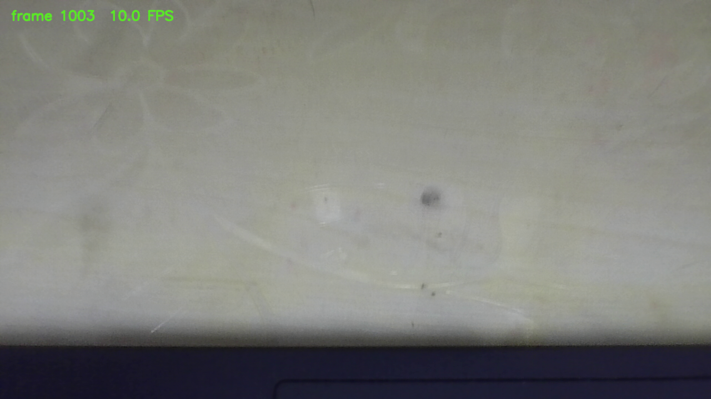

# 摄像头并发重构作业（camera_monitor）

把单线程摄像头程序重构为"后台采集 + 主线程 UI"的并发组件，保持外部行为不变：

```text
sturdy-guide-camera [--device INDEX] [--width PIXELS] [--height PIXELS]
```

按键行为保持不变：`S` 保存截图到 `captures/`，`Q` 或关闭窗口退出。

## 目录结构

```text
camera_monitor/
├── starter/main.cpp       原始单线程版本（保留对照，不参与构建）
├── include/camera/        公共接口（FrameSource、CameraSession 等声明）
├── src/                   实现（设备、假设备、采集会话）
├── app/main.cpp           参数解析、依赖组装和窗口循环
├── tests/                 不依赖真实摄像头的自动测试
├── CMakeLists.txt         查找依赖并编排子目录
└── README.md              本文档
```

## 构建与运行

```bash
cmake -S . -B build-camera -G Ninja -DSTURDY_GUIDE_BUILD_CAMERA_HOMEWORK=ON
cmake --build build-camera
./build-camera/sturdy-guide-camera --device 0
```

## 自动测试

测试全部基于 `FakeFrameSource`，不依赖真实摄像头：

```bash
ctest --test-dir build-camera --output-on-failure
```

本地结果：`100% tests passed, 0 tests failed out of 5`（含 `camera_session_test` 七条验证：递增帧号、重复 start、连续 stop、析构 join、丢帧策略、错误传递、空帧拒绝）。

## 重构前后的职责对比

**重构前（starter/main.cpp，单线程）**：`main()` 一个人完成参数解析、打开设备、读帧、FPS 统计、画字、显示、按键、存图、错误处理；读帧阻塞 UI；依赖真实硬件，无法稳定测试；没有采集线程生命周期。

**重构后**：

| 职责 | 归属 |
| --- | --- |
|帧来源的抽象接口 | `FrameSource` |
| 真摄像头 | `OpenCvCamera`（`cv::VideoCapture`） |
| 测试用假摄像头 | `FakeFrameSource`（确定性帧 / 可模拟失败） |
| 后台采集线程、两帧缓冲、启停、异常传递 | `CameraSession` |
| 窗口、键盘、画面叠加、截图 | `app/main.cpp`（主线程 UI） |
| 硬件无关验证 | `tests/`（CTest） |

核心逻辑编译为 `camera_core` 库；应用与测试分别链接该库；依赖使用 `find_package(OpenCV)` 与 `find_package(Threads)`，未写死库路径。

## 线程安全契约与状态机

`CameraSession` 状态机：

```text
Idle → Running（start()）
Running → Failed（后台取帧抛错）
Running / Failed → Idle（stop() 完成线程 join 后）
```
- `start()`：仅控制线程、且状态为 Idle 时调用；Running/Failed 时再次调用抛 `std::logic_error`。
- `stop()`：可被任意线程调用，幂等；Idle 时为空操作。
- `state()` / `error()` / `consume_latest()`：内部加锁，由主线程调用。
- 资源所有权：`CameraSession` 以 `std::unique_ptr<FrameSource>` 独占摄像头并负责其生命周期；`OpenCvCamera` 持有已打开的 `cv::VideoCapture`，构造失败即抛异常。
- 缓冲与丢帧：缓冲有界（最多两帧 `newest_` / `oldest_`），满时新帧覆盖最旧帧——丢旧保新，画面始终最新、内存有界。
- 锁范围：`mutex_` 只保护 `stop_requested_`、`state_`、`error_` 与两帧槽；`read()`、`imshow()`、`imwrite()` 等慢/阻塞 I/O 一律在锁外执行，避免持锁等待摄像头。
- 异常跨线程：后台 `catch(...)` 用 `std::current_exception()` 冻结为 `exception_ptr` 存入 `error_` 并置 `kFailed`；主线程观察后 `std::rethrow_exception()` 重抛，再以 `try/catch` 报告，异常类型完整保留。
- 析构顺序：`stop()`（置 `stop_requested_`）→ `notify_all()` 唤醒 → `join()` 等后台退出 → 置 `kIdle` → 之后才销毁成员。

## 真机测试记录

- 设备：笔记本内置摄像头（`Integrated Camera`，`/dev/video0`）
- 操作系统：Ubuntu 22.04.5 LTS (jammy)
- 分辨率：1280×720
- 结果：窗口实时显示、`S` 保存、`Q` 干净退出
- 运行截图：
